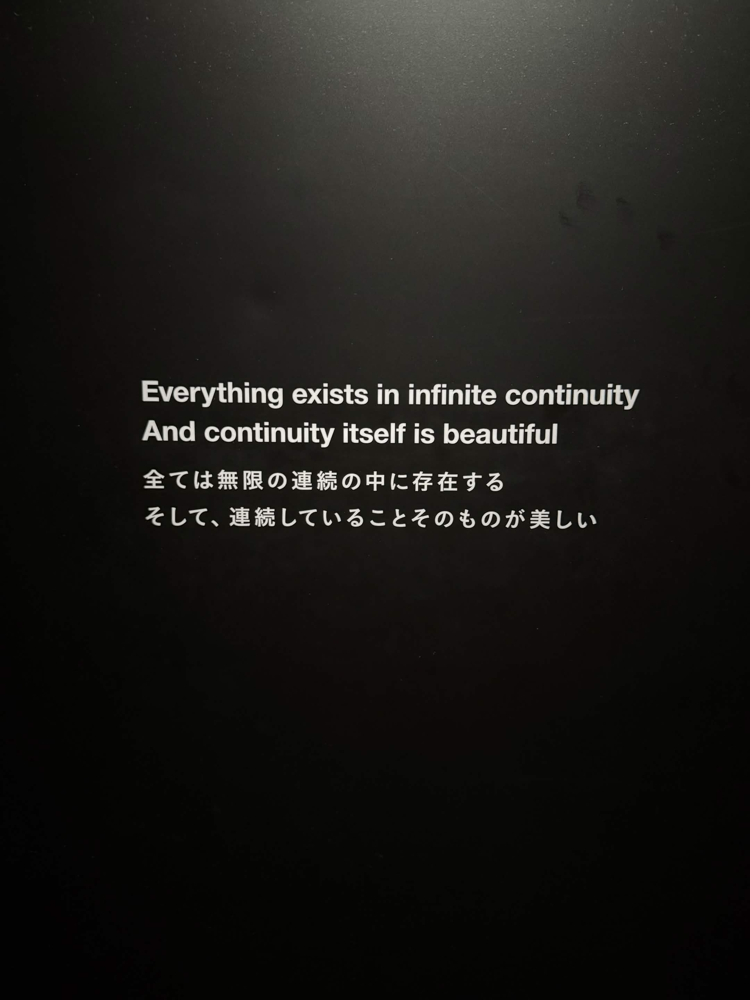
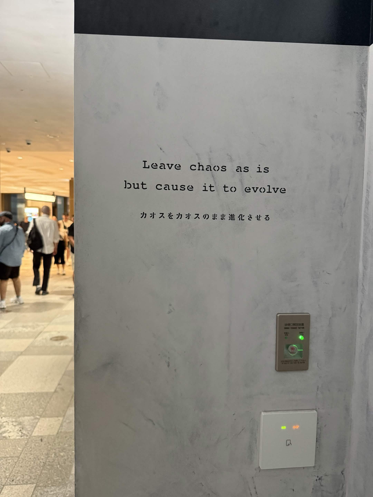

# 20261012

<figure><figcaption></figcaption></figure> <figure><figcaption></figcaption></figure>

> The frame feels clean enough. Translating involves taste, and I have some, so here are mine.
>
> **First sign:** 全ては無限の連続の中に存在する / そして、連続していることそのものが美しい
>
> > Everything exists within an endless succession.\
> > And the very fact that it goes on, unbroken, is beautiful.
>
> The official "continuity itself" reads as an abstract noun, but the Japanese says 連続していること, "the state of being continuous," the ongoing-ness. こと turns it into a fact you're pointing at, not a concept. 連続 also has a sense of things following one after another, a chain or sequence, which "succession" captures a little better than "continuity." So the beauty isn't in some property called continuity. It's in the plain fact that nothing breaks off.
>
> **Second sign:** カオスをカオスのまま進化させる
>
> > Let chaos evolve as chaos.
>
> The official version adds a "but" ("leave chaos as is, but cause it to evolve"), which makes it sound like two instructions in tension. The Japanese is one move: のまま means "while remaining as it is," so it's evolution that never stops being chaos. 進化させる is causative and could be "make" or "let." I lean toward "let" because the spirit seems more like tending than forcing, but "make" is defensible. If I wanted something punchier, I'd say "Evolve chaos without taming it."
>
> These look like teamLab's wall text, and both lines fit their whole aesthetic: no borders, no clean resolution, just things flowing into each other.
