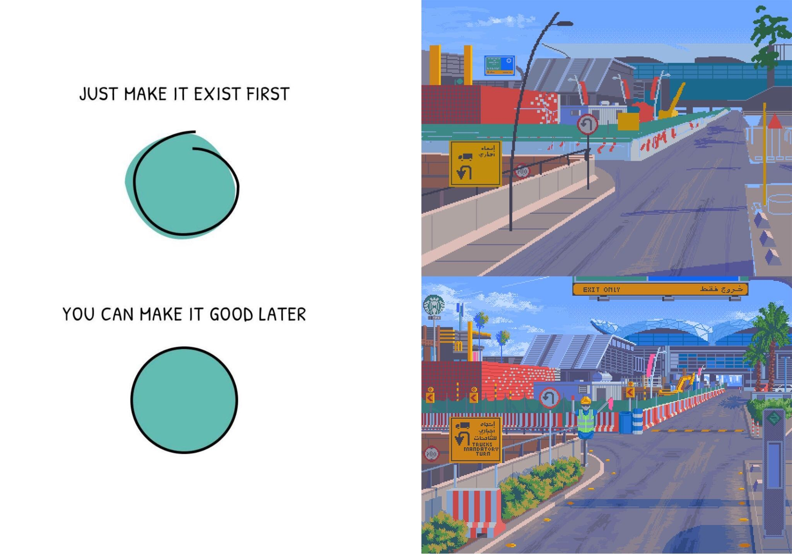
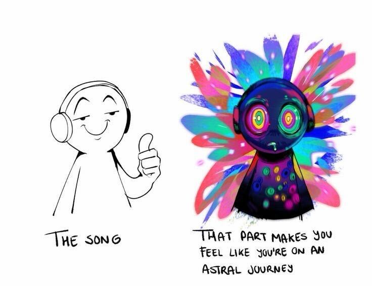
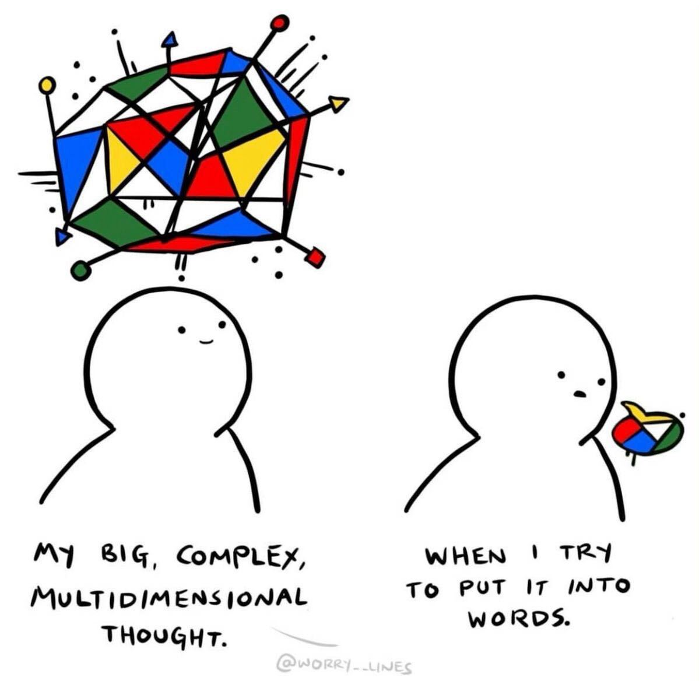

# 20261117

> I can't remember yesterday, but I recognize it.

okay - I ~~think~~ know (I know because I decided to test the thought-of structure and I found it sound and so I _moved in_ and it became part of my operating structure, my lifestyle is the ongoing existence proof) that yesterday isn't here, and what I can see of it _by any means_ all qualifies as memory-stuff. if I recognize something of yesterday, it's indistinguishable from memory. I hardcore suspect that all minds work like this, and some don't have frame-by-frame language for the qualification-for-memory phase of it, the kind of structured understanding that lets one deliberately evaluate the process from a subshell that has its own time.

since I started doing that, my _apparent_ memory has gotten much better. like, I used to think my memory was just shit. now, I think it's enactive/stigmergic, and I don't think I can be sure that anyone else's memory isn't also a composed/encountered thing.

***

1 / 2 / 3 / 4 - pls view in order:

<figure><figcaption></figcaption></figure> <figure><figcaption></figcaption></figure> <figure><figcaption></figcaption></figure> <figure><figcaption></figcaption></figure>

